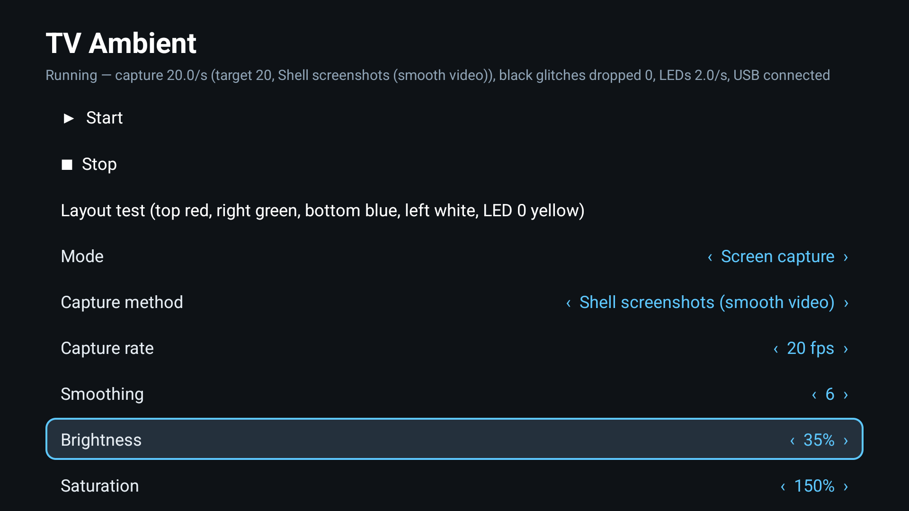
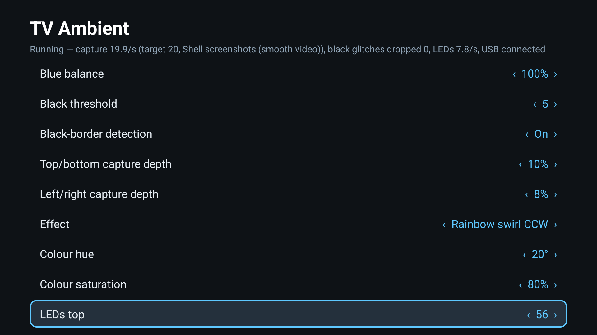
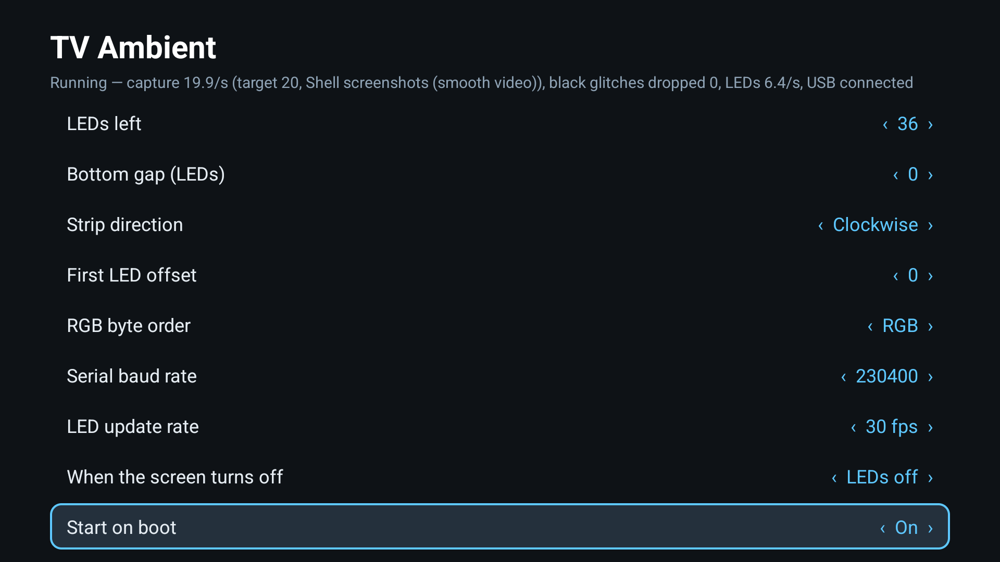

<div align="center">

# TV Ambient

**Ambient lighting for Android TV that doesn't make your video stutter.**

Drive an LED strip behind your TV from the picture on screen, through a cheap USB LED controller,
with 1080p playback kept at full frame rate.

[](LICENSE)


[](../../releases/latest)



</div>

---

## Why another ambient-light app?

Most ambient-light apps for Android TV record the screen with Android's MediaProjection API. On many
MediaTek/MStar based TVs (Haier, TCL, Hisense, Xiaomi and others) every recorded frame forces the TV's display
service to copy the video plane on the CPU. The result: **1080p video drops to about half its frame rate** as soon
as the lights are on.

TV Ambient takes small one-shot screenshots instead, at a fixed rate, the same way Android's own `screencap`
tool does. Nothing is recorded between shots, so the player keeps its frames.

Measured on a Haier K66 (Android TV 14), 1080p 23.98 fps video in Nuvio:

| Lights | Video frame rate | Frame gaps over 60 ms (per ~126 frames) |
|---|---|---|
| Off | 23.98 fps | 0 |
| Typical screen-recording ambient app | **13-17 fps** | 70-126 |
| **TV Ambient** (shell screenshots, 10/s) | **23.97 fps** | 3 |

## Features

- **Smooth video**: shell-screenshot capture keeps 1080p playback at full speed (see above)
- **Fallback capture**: standard screen recording for TVs where ADB is not available
- **Picture tuning**: brightness, saturation, gamma, red/green/blue balance, black threshold, smoothing
- **Letterbox aware**: black-border detection for 21:9 films and 4:3 content
- **Any layout**: LEDs per side, a gap behind the stand, clockwise or counter-clockwise, first-LED offset,
  RGB byte order, layout test pattern
- **Lights without video**: single colour and five effects (rainbow swirl both ways, breathing, running light,
  slow colours)
- **Set and forget**: starts on boot, turns the LEDs off with the screen
- **Remote friendly**: one D-pad settings screen; no phone app, no account, no cloud
- **Light**: about 150 KB, plain Java, uses about 5-8% CPU on a 4-core TV SoC

<p align="center">
  
  
</p>

## What you need

| | |
|---|---|
| **TV** | Android TV / Google TV 10 or newer with a USB port |
| **LED controller** | Any USB serial board running an **Adalight** compatible firmware: ESP8266 (D1 mini), ESP32, Arduino Nano/Uno with CH340, CP210x or FTDI USB chips |
| **LED strip** | Addressable strip supported by your controller firmware (WS2812B, SK6812, ...) |
| **For smooth video** | Developer options with **USB debugging** turned on (see [Security](#security)) |

## Install

1. **Download** `tv-ambient-<version>.apk` from the [latest release](../../releases/latest).
2. **Sideload** it with any of these:
   - [Downloader](https://www.aftvnews.com/downloader/) or a file manager on the TV, from a USB stick
   - ADB from a computer:
     ```bash
     adb connect <tv-ip>:5555
     adb install tv-ambient-1.3.0.apk
     ```
     (On Android 14, if `adb install` hangs: `adb push` the APK to `/data/local/tmp/` and run
     `adb shell pm install -r /data/local/tmp/tv-ambient-1.3.0.apk`.)
3. **Enable USB debugging** for smooth-video capture: Settings → Device Preferences → About → press OK on
   *Build* 7 times, then Developer options → **USB debugging** on.
4. **Plug in** your LED controller, open **TV Ambient** and press **Start**.
5. **Accept two prompts on the TV**:
   - *Allow USB debugging?* for TV Ambient: tick **Always allow**, then **Allow**
   - *Allow TV Ambient to access USB Serial?*: **OK**
6. Run **Layout test**: the top edge should light red, right green, bottom blue, left white, and the first LEDs
   blink yellow. Adjust *LEDs top/right/bottom/left*, *Strip direction* and *First LED offset* until it does.

Only one app can use the LED controller at a time: stop any other ambient-light app first.

## Configure

Everything is on one screen. Use **Up/Down** to move, **Left/Right** to change a value, **OK** on the actions.

| Setting | Default | Notes |
|---|---|---|
| Capture method | Shell screenshots | *Screen recording* works without USB debugging but makes 1080p stutter on affected TVs |
| Capture rate | 20 fps | 10-20 is plenty for lighting; lower it if a heavy video still drops frames |
| Smoothing | 6 | 1 = instant, 10 = very soft |
| Brightness / Saturation / Gamma | 35% / 150% / 1.9 | |
| Black threshold | 5 | Dark scenes below this turn the LEDs off instead of a dim grey |
| Capture depth | 10% top/bottom, 8% sides | How far into the picture each LED looks |
| LED update rate | 30 fps | Smooth fades between captured frames |
| Serial baud rate | 230400 | Must match your controller firmware |

The defaults are the calibration of the reference setup (43" TV, 184 LEDs: 56 top, 36 right, 56 bottom, 36 left).

## Build from source

The only requirement is **Docker**. The image contains JDK 17 and the Android SDK 34; nothing is installed on
your machine.

```bash
git clone https://github.com/noman13/android-tv-ambient-light.git
cd android-tv-ambient-light
scripts/build.sh                 # Linux, macOS, Git Bash
```

```powershell
.\scripts\build.ps1              # Windows PowerShell
```

The APK lands in `dist/tv-ambient-<version>.apk`. The first build creates the `tv-ambient-build` image and
fills the `tv-ambient-gradle` cache volume (a few minutes); later builds take well under a minute.

By default the APK is signed with the build container's debug key, which is fine for your own TV. To sign
releases with your own key, put a `keystore.properties` next to your keystore:

```properties
storeFile=release.jks
storePassword=...
keyAlias=...
keyPassword=...
```

and point the build at that folder (keep it outside the repository):

```bash
KEYSTORE_DIR=/path/to/keys scripts/build.sh
```

```powershell
.\scripts\build.ps1 -KeystoreDir C:\path\to\keys
```

Or build the image and run Gradle yourself:

```bash
docker build -t tv-ambient-build docker/
docker run --rm -v "$PWD:/src" -v tv-ambient-gradle:/gradle -w /src tv-ambient-build \
  sh ./gradlew --no-daemon assembleRelease
```

## How it works

```
 TV picture ──► ShellCapture (runs as shell via the TV's own ADB, 127.0.0.1:5555)
                   one 128×72 screenshot per tick, streamed as raw RGB
                        │
                        ▼
              TV Ambient service ── edge sampling per LED ── letterbox detection
                        │           colour processing (LUTs) ── smoothing at 30 fps
                        ▼
              USB serial (CH340/CP210x/FTDI) ── Adalight packets ──► LED controller ──► strip
```

Taking screenshots needs the shell user's permission, which an app cannot have. TV Ambient therefore connects to
the TV's own ADB daemon with its own key (the *Allow USB debugging?* prompt) and starts a small helper from its
own APK with `app_process`, the same approach as Shizuku and scrcpy. The full design notes, measurements and
the approaches that were tried and dropped are in [AGENTS.md](AGENTS.md).

## Security

Smooth-video capture relies on **USB debugging**, and accepting the *Allow USB debugging?* prompt gives TV Ambient
shell-level access on your TV. Things to know:

- On many TVs, USB debugging also keeps **network ADB on port 5555 open** on your home network. Anyone on that
  network can request a connection; the TV still asks for approval on screen, so never accept a prompt you did
  not trigger yourself.
- TV Ambient only talks to `127.0.0.1:5555` on the TV itself. It has no analytics, no telemetry and contacts no
  server.
- To withdraw access: Developer options → **Revoke USB debugging authorisations**. To avoid ADB altogether,
  choose *Capture method → Screen recording*.

## Troubleshooting

| Symptom | Fix |
|---|---|
| Status says *Shell capture unavailable* | USB debugging off, or the *Allow USB debugging?* prompt was dismissed. Turn it on and press Start again. |
| *No USB LED controller found* | Check the cable (some are charge-only) and that the board shows up as a serial device. |
| LEDs stay dark | Baud rate or firmware mismatch: the controller must run an Adalight-compatible sketch at the selected baud rate. |
| Colours on the wrong side or mirrored | Run *Layout test* and adjust direction, offset and LEDs per side. |
| Wrong colours (red shows green) | Change *RGB byte order*. |
| Video still stutters | Lower *Capture rate* to 10 fps. |
| The USB LED controller goes dark while USB debugging is on | Some TVs cut power to a USB port in debugging mode. Try the other port. |

## Compatibility

| TV | Android | Status |
|---|---|---|
| Haier K66 (H43K66UG, MediaTek m7332) | TV 14 | ✅ Reference device: smooth 1080p with shell screenshots |

Tested your TV? Please open an issue or a pull request to add it; see [CONTRIBUTING.md](CONTRIBUTING.md).

## Contributing

Issues and pull requests are welcome. Read [CONTRIBUTING.md](CONTRIBUTING.md) and the technical guide in
[AGENTS.md](AGENTS.md) first.

## Acknowledgements

- [usb-serial-for-android](https://github.com/mik3y/usb-serial-for-android) (MIT) for the USB serial drivers
- [dadb](https://github.com/mobile-dev-inc/dadb) (Apache 2.0) for the ADB client
- The Adalight protocol from the [Adafruit Adalight](https://github.com/adafruit/Adalight) project

"Ambilight" is a trademark of Koninklijke Philips N.V.; this project is not affiliated with Philips.

## License

[MIT](LICENSE) © 2026 Abdullah Al Noman
